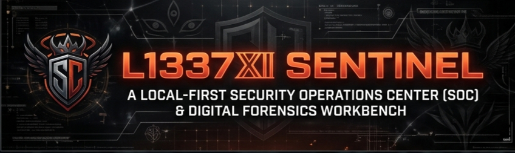

**A local-first Security Operations Center (SOC) and digital forensics workbench.**

SENTINEL is a self-hosted security operations platform under active development. Its goal is to give analysts one local workspace for collecting security telemetry, investigating detections, preserving evidence, and documenting incidents—without requiring paid SaaS services or hosted AI APIs.

> **Development status:** Early foundation release. The current implementation contains a FastAPI service, SQLite-backed event ingestion and retrieval, and an initial React/TypeScript dashboard. Detection engineering, correlation, case management, forensic workflows, network analysis, and reporting are planned work, not shipped capabilities. This is not yet a production SIEM, EDR, or incident-response platform.

## Design objectives

- **Local-first operation:** services bind to loopback by default.
- **Clear boundaries:** ingestion, normalization, detection, correlation, investigation, and reporting remain separate concerns.
- **Evidence integrity:** preserve source artefacts, hash them, and record handling actions as forensic workflows are implemented.
- **Analyst-led response:** no automatic execution of uploaded files and no arbitrary shell execution from the dashboard.
- **Honest detection:** distinguish raw observations, rule matches, analyst assessments, and confirmed findings.
- **Maintainability:** typed interfaces, explicit configuration, tests, and documented operational assumptions.

## How the platform is intended to work

1. **Ingest** supported events and artefacts from local sources.
2. **Validate and normalize** source-specific records into a consistent event model.
3. **Persist** structured events in a local database while retaining original evidence separately.
4. **Detect** suspicious patterns using versioned rules.
5. **Correlate** related observations into timelines and incident candidates.
6. **Investigate** with event pivots, evidence references, analyst notes, and case history.
7. **Report** findings with traceable references to the underlying evidence.

The current implementation includes local event ingestion, one deterministic authentication detection rule, alert triage, append-only audit records, read-only host inventory, scoped private-network discovery, and an initial incident-case workflow. Sigma interoperability, broad event-source adapters, evidence acquisition, YARA, PCAP analysis, authentication, and release hardening remain on the roadmap.

### Host assessment (feature branch)

The Host Assessment workflow extends the existing system scan with a bounded, read-only local review. It collects the existing host inventory, hashes eligible regular files with SHA-256, checks an optional operator-supplied local hash-indicator file, and invokes ClamAV only when `clamscan` is already installed. It also inventories common Linux startup locations and privileged accounts and reviews selected firewall and SSH configuration.

The default filesystem scan starts at `/`, skips virtual filesystems, caches and common dependency directories, and is limited to 50,000 files, 64 MiB per file and 180 seconds for the SENTINEL hash pass. ClamAV has its own 90-second timeout. The report records exclusions, skipped files, truncation and scanner availability. These bounds mean that a completed assessment is not proof that every file was inspected.

To provide local SHA-256 indicators, create a JSON file such as `/etc/sentinel/hash_iocs.json` and set `SENTINEL_HASH_DB` for the backend service:

```json
{
  "indicators": {
    "0000000000000000000000000000000000000000000000000000000000000000": {
      "label": "Analyst-provided sample name",
      "severity": "critical",
      "description": "Source and context for this indicator",
      "capabilities": [
        {"id": "network_communication", "label": "Network communication"}
      ]
    }
  }
}
```

Only valid 64-character hexadecimal SHA-256 keys are loaded. No remote threat-intelligence feed or built-in malware database is included. ClamAV uses its already-installed local signatures; SENTINEL does not install ClamAV or update signatures. Static script-pattern matches are low-confidence leads, not proof of malicious execution. Suspicious files are never executed, modified, quarantined or uploaded. The dashboard can export the assessment as JSON.


## Capability status

| Area | Status |
|---|---|
| FastAPI application and health endpoint | Implemented in foundation |
| SQLite event persistence | Implemented in foundation |
| JSON event ingestion and retrieval | Implemented in foundation |
| Initial SOC dashboard shell | Implemented in foundation |
| Authentication and role-based access control | Not implemented |
| Windows, Sysmon, and Linux log parsers | Planned |
| Sigma-compatible and custom detection | Planned |
| Detection alerts and alert lifecycle | Implemented (initial rule set) |
| Incident cases, linked events, notes, and timelines | Implemented (initial workflow) |
| Event correlation and investigation timelines | Planned |
| Evidence hashing and chain of custody | Planned |
| YARA-assisted file analysis | Planned |
| Offline PCAP analysis; Zeek/Suricata integration | Planned |
| Audit, exports, backup and restore | Planned |
| Optional local Ollama assistance | Future integration; not required |

## Architecture

The initial release uses a **modular monolith**. This keeps deployment and debugging straightforward while preserving clear internal boundaries. Separate services or distributed workers should be introduced only when operational needs justify their complexity.

```text
Analyst browser
    |
React + TypeScript dashboard
    |
REST / JSON API
    |
FastAPI application
    +-- ingestion and validation
    +-- event services
    +-- detection (planned)
    +-- correlation (planned)
    +-- case management (planned)
    |
SQLite (initial persistence)
    |
Local evidence and report storage
```

### Technology

- Backend: Python 3.11+, FastAPI, Pydantic, Python's SQLite driver.
- Frontend: React, TypeScript, Vite.
- API: REST/JSON.
- Planned integrations: Sigma, YARA, Zeek, Suricata, Scapy, and platform-specific event sources.
- Optional local AI: Ollama. No external AI API is a core dependency.

## Repository layout

```text
backend/app/   API routes, validation, and SQLite persistence
backend/tests/ API tests
frontend/src/  React/TypeScript analyst interface
.github/       Continuous integration workflow
docs/          Architecture, security guidance, and roadmap
storage/       Reserved for local evidence (not committed)
```

## Requirements

- Linux (Kali Linux is a development target).
- Python 3.11 or newer.
- Node.js 20 or newer and npm.
- Git.

The application is designed to run without Docker, paid services, or system-wide Python package installation.

## Local development

Run commands from the repository root. Use a dedicated virtual environment; do not install project dependencies into the system Python environment.

### Backend

```bash
cd backend
python3 -m venv .venv
source .venv/bin/activate
python -m pip install --upgrade pip
pip install -e ..
uvicorn app.main:app --host 127.0.0.1 --port 8787
```

API base URL: `http://127.0.0.1:8787`  
Interactive API reference: `http://127.0.0.1:8787/docs`

### Frontend

In a second terminal:

```bash
cd frontend
npm install
npm run dev
```

Dashboard: `http://127.0.0.1:5176`

### Smoke test

```bash
curl --fail http://127.0.0.1:8787/api/health
```

Example event:

```bash
curl --fail-with-body -X POST http://127.0.0.1:8787/api/events \
  -H 'Content-Type: application/json' \
  -d '{
    "source": "manual-test",
    "event_type": "authentication",
    "severity": "low",
    "message": "Example successful login",
    "host": "lab-linux",
    "occurred_at": "2026-11-17T12:00:00Z",
    "metadata": {"user": "analyst", "result": "success"}
  }'
```

Retrieve events:

```bash
curl --fail http://127.0.0.1:8787/api/events
```

The default database is created at `backend/data/sentinel.db`. This directory is excluded from Git.

## Security notes

- **Do not expose the development API or Vite server to a network.** Authentication and authorization are not yet implemented.
- Treat every imported event, file, archive, and packet capture as untrusted input.
- Never execute uploaded files. Malware analysis must be performed in a properly isolated lab.
- Keep original evidence immutable; analyze working copies and record hashes and handling steps.
- Do not ingest customer data or sensitive evidence into this early development release.
- Never commit credentials, tokens, private logs, PCAPs, memory dumps, malware samples, or customer artefacts.
- A detection rule match is an investigative lead, not proof of compromise.

See [docs/SECURITY.md](docs/SECURITY.md) for additional guidance.

## Development roadmap

The project is intended to progress through these milestones:

1. Reliable foundation, configuration, schema validation, and event ingestion.
2. Event search, filtering, severity handling, and alert lifecycle.
3. Detection rules, Sigma interoperability, and threat-hunting workflows.
4. Correlation, incident cases, and investigation timelines.
5. Forensic evidence intake, hashing, metadata, YARA workflow, and chain of custody.
6. Offline PCAP analysis and optional Zeek/Suricata integrations.
7. Audit trail, exports, reporting, backup, and restore.
8. Security review, automated test coverage, packaging, and release hardening.

See [docs/ROADMAP.md](docs/ROADMAP.md) and [docs/ARCHITECTURE.md](docs/ARCHITECTURE.md).

## Contributing

SENTINEL is currently published for visibility and project development. The repository's proprietary license governs use of the source. Please do not submit code, rules, datasets, or documentation copied from third parties unless their terms permit redistribution. Include attribution and license information for any permitted third-party material.

## Ownership and license

Copyright (c) 2026 L1337Xi. All rights reserved. See [LICENSE](LICENSE). Public visibility does not grant permission to copy, modify, redistribute, sublicense, or commercially exploit this code. Third-party components remain subject to their own licenses.

## Credits

Created and maintained by **L1337Xi**.
